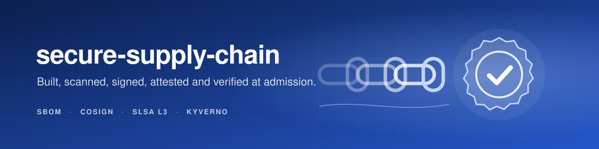
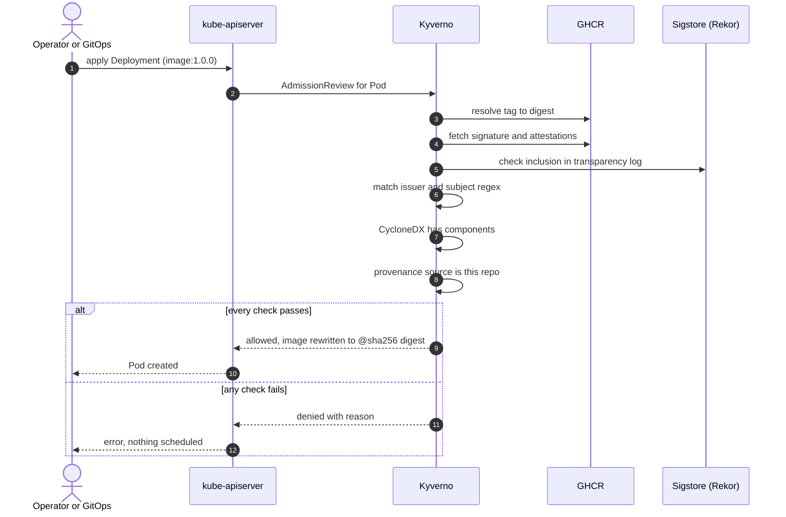
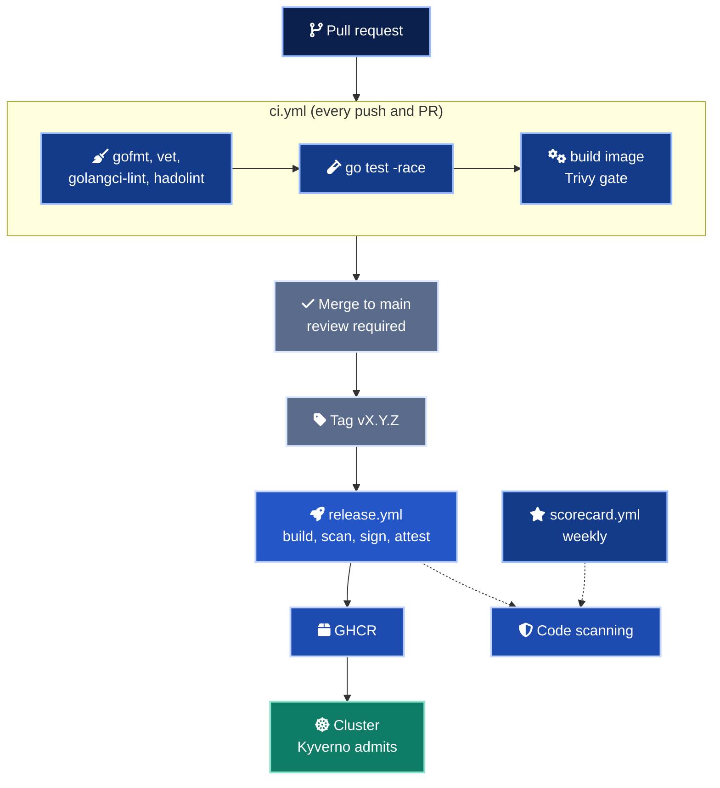

<div align="center">



# secure-supply-chain

A reference software supply chain where every image is provably built by this repository, scanned, signed, attested and verified again by the cluster before it runs.

<p>


</p>

</div>

## In numbers

| Measure | Count | Source |
| --- | ---: | --- |
| GitHub workflows | 3 | `ci`, `release`, `scorecard` |
| Release jobs, each with its own permissions | 6 | `release.yml` |
| Third-party actions pinned to a commit SHA | 18 | all workflows |
| Independent vulnerability gates | 2 | Trivy, Grype |
| Signed artefacts per release | 5 | image signature, CycloneDX, SPDX, SLSA provenance, GitHub attestation |
| Kyverno policies (rules) | 3 (6) | `policies/kyverno/` |
| Gatekeeper constraint rules | 4 | `policies/gatekeeper/` |
| Threats mapped to a control | 17 | [threat model](docs/threat-model.md) |
| Unit tests (statement coverage of handlers) | 6 (100%) | `app/internal/server` |
| Long-lived signing keys | 0 | keyless, see [ADR 0001](docs/adr/0001-keyless-signing.md) |

## What it is

Most pipelines prove that code compiles. This one proves where an image came from. A tag push builds a small Go service into a distroless image, inventories it twice, scans it twice, signs it with an identity that belongs to the release workflow and to nothing else, and publishes SLSA Build L3 provenance. On the cluster side, Kyverno refuses any pod whose image cannot show all of that evidence.

The service itself is intentionally tiny. The product here is the chain of custody around it, and it is built to be copied into a real repository by changing one owner name.

## Pipeline

```mermaid
flowchart LR
    tag(["fa:fa-tag git tag vX.Y.Z"]):::trigger

    subgraph build["Build"]
        direction TB
        b1["fa:fa-cogs Buildx<br/>distroless, non-root"]:::build
        b2["fa:fa-box Push to GHCR<br/>by digest"]:::build
        b1 --> b2
    end

    subgraph verify["Verify"]
        direction TB
        v1["fa:fa-list SBOM<br/>SPDX + CycloneDX"]:::verify
        v2["fa:fa-search Trivy<br/>fail on CRITICAL"]:::verify
        v3["fa:fa-search Grype<br/>second opinion"]:::verify
        v1 --> v2 --> v3
    end

    subgraph sign["Sign"]
        s1["fa:fa-signature Cosign keyless<br/>Fulcio + Rekor"]:::sign
    end

    subgraph attest["Attest"]
        direction TB
        a1["fa:fa-file-signature SBOM attestation"]:::attest
        a2["fa:fa-certificate SLSA L3 provenance"]:::attest
        a3["fa:fa-github GitHub attestation"]:::attest
    end

    subgraph admit["Admit"]
        k1["fa:fa-shield-alt Kyverno<br/>verifyImages"]:::admit
        k2["fa:fa-server Pod runs<br/>pinned to digest"]:::run
        k1 --> k2
    end

    tag --> b1
    b2 --> v1
    v3 --> s1
    v3 --> a2
    v3 --> a3
    s1 --> a1
    a1 --> k1
    a2 --> k1

    classDef trigger fill:#0b1f4d,stroke:#9bbcff,color:#ffffff,stroke-width:2px
    classDef build fill:#143a8a,stroke:#9bbcff,color:#ffffff,stroke-width:2px
    classDef verify fill:#1d4bb0,stroke:#c3d5ff,color:#ffffff,stroke-width:2px
    classDef sign fill:#2456c8,stroke:#c3d5ff,color:#ffffff,stroke-width:2px
    classDef attest fill:#3a6ae0,stroke:#dbe6ff,color:#ffffff,stroke-width:2px
    classDef admit fill:#0e7c66,stroke:#8de0cb,color:#ffffff,stroke-width:2px
    classDef run fill:#0b1f4d,stroke:#8de0cb,color:#ffffff,stroke-width:2px
```



Nothing is signed until both scanners pass. Nothing is admitted unless the signature, the SBOM and the provenance all verify against the expected identities.

## Admission, step by step



## Controls

| Threat | Control | Where |
| --- | --- | --- |
| Compromised third-party action | Every action pinned to a commit SHA, egress audited | `.github/workflows/`, `dependabot.yml` |
| Over-privileged workflow token | `permissions: {}` at the top, per-job grants | `release.yml` |
| Stolen signing key | No key exists. Ten-minute certificate tied to the workflow identity | `release.yml` (`sign`) |
| Known critical CVE shipped | Two scanners with different databases, both blocking | `release.yml` (`scan`), `ci.yml` |
| Unknown component, new CVE later | Attested SBOM in two formats, re-scannable without a rebuild | `release.yml` (`sbom`, `sign`) |
| Forged or tampered provenance | Isolated SLSA L3 generator with its own identity | `release.yml` (`provenance`) |
| Image pushed by hand to the registry | Admission requires the release workflow signature | `verify-image-signature.yaml` |
| Tag moved after verification | Sign digests only, rewrite tag to digest at admission | `release.yml`, `verify-image-signature.yaml` |
| Mutable `:latest` in production | Never published, denied at admission | `release.yml`, `disallow-latest-tag.yaml` |
| Container breakout | Non-root, no capabilities, seccomp, no privilege escalation | `require-non-root.yaml`, `deploy/k8s/` |
| Tooling dropped into a running container | Distroless, read-only root filesystem | `app/Dockerfile`, `deployment.yaml` |
| Lateral movement | Default-deny NetworkPolicy, no service account token | `networkpolicy.yaml`, `serviceaccount.yaml` |

The full model, with seventeen threats across source, build, dependencies, distribution, deployment and runtime, is in [docs/threat-model.md](docs/threat-model.md).

## Quick start

Run the tests and the service locally.

```bash
cd app
go test -race -cover ./...
go run ./cmd/server &
curl -s localhost:8080/version
kill %1
```

Build the hardened image.

```bash
docker build -t secure-supply-chain:dev --build-arg VERSION=dev app
docker run --rm --read-only --cap-drop ALL --security-opt no-new-privileges -p 8080:8080 secure-supply-chain:dev
```

Verify a published release exactly as the cluster does.

```bash
brew install cosign slsa-verifier jq
scripts/verify.sh ghcr.io/marlyngiselle/secure-supply-chain:1.0.0
```

Install the admission policies and deploy.

```bash
kubectl apply -f policies/kyverno/
kubectl apply -k deploy/k8s/
```

## Delivery



| Step | Trigger | Automatic | Human decision |
| --- | --- | :---: | --- |
| Lint, test, build, scan | Push or pull request | yes | |
| Merge | Pull request | | Review and approval |
| Release | Tag `vX.Y.Z` | yes | Who may push tags |
| Dependency bumps | Dependabot, weekly | yes | Review of each bump |
| Scorecard | Weekly and on `main` | yes | |

## Before you touch anything

> [!IMPORTANT]
> Replace the owner before the first release. The policy regex, `scripts/verify.sh` and the deployment all name `marlyngiselle/secure-supply-chain`. A fork that keeps them will build and sign correctly and then have every pod denied, because the signing identity is the fork's, not this repository's.

> [!WARNING]
> The Dockerfile references base images by tag with a digest placeholder comment. Pin both `FROM` lines to `@sha256` digests before the first release. Until then a registry-side tag change silently alters what you build, and Dependabot has no digest to update.

> [!WARNING]
> Cosign 3 writes signatures in the Sigstore bundle format by default. Check that your admission controller version reads that format, and run `scripts/verify.sh` plus a test pod against a staging cluster before switching any policy to `Enforce`.

> [!CAUTION]
> `verify-image-signature` runs with `validationFailureAction: Enforce` and makes Sigstore part of the pod creation path. Run Kyverno with several replicas, decide the webhook failure policy per environment, and keep an audited break-glass namespace excluded from the policy. Otherwise an outage of Rekor or GHCR stops every rollout.

> [!NOTE]
> The SLSA generator is referenced by tag (`@v2.1.0`), not by SHA. That is required by the generator and is the single expected `Pinned-Dependencies` finding in Scorecard. See [ADR 0003](docs/adr/0003-slsa-provenance-generator.md).

## Repository map

```text
.
├── app/                         Go service, Dockerfile, lint config
│   ├── cmd/server/              entrypoint with graceful shutdown
│   └── internal/server/         handlers, security headers, tests
├── .github/
│   ├── workflows/
│   │   ├── ci.yml               lint, test, build, scan
│   │   ├── release.yml          build, SBOM, scan, sign, attest, SLSA
│   │   └── scorecard.yml        OpenSSF Scorecard
│   ├── dependabot.yml           actions, docker, gomod
│   └── assets/                  README banner
├── policies/
│   ├── kyverno/                 signature, SBOM, provenance, tags, non-root
│   └── gatekeeper/              non-root and read-only rootfs (alternative)
├── deploy/k8s/                  namespace, Deployment, Service, NetworkPolicy, PDB
├── scripts/verify.sh            verify any release from a laptop
└── docs/                        threat model, SLSA mapping, how to verify, ADRs
```

## Documentation

| Document | What it answers |
| --- | --- |
| [Threat model](docs/threat-model.md) | Where the supply chain can be attacked and which control stops each attack |
| [SLSA mapping](docs/slsa.md) | Which SLSA Build requirement each artefact meets, and what remains partial |
| [Verify an image yourself](docs/verify-an-image.md) | Every check, one command at a time, and what each failure means |
| [ADR 0001](docs/adr/0001-keyless-signing.md) | Why keyless signing instead of a managed key pair |
| [ADR 0002](docs/adr/0002-kyverno-for-admission.md) | Why Kyverno over the policy-controller or Gatekeeper |
| [ADR 0003](docs/adr/0003-slsa-provenance-generator.md) | Why provenance comes from an isolated generator |

<div align="center">
<br>
<sub>Built by Giselle Da Costa. MIT licensed.</sub>
</div>
