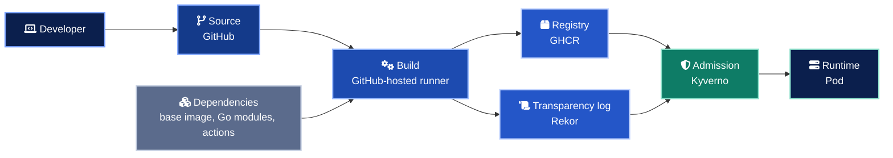

# Supply chain threat model

This document walks the path of a change from a developer laptop to a running pod and names, for each step, how it can be attacked and which control in this repository stops it. The structure follows the SLSA threat categories (source, build, dependencies, distribution, deployment), so it maps directly onto [SLSA levels](slsa.md).

## Assets

| Asset | Why it matters |
| --- | --- |
| Source on `main` and release tags | Everything downstream trusts it |
| Release workflow (`.github/workflows/release.yml`) | Its OIDC identity is the signing key |
| Container image in GHCR | What actually runs |
| SBOM, signature, provenance | The evidence that lets a cluster say no |
| Admission policies | The last gate, and the only one an attacker meets at runtime |

## Trust boundaries

Every arrow is a boundary where integrity can be lost. The controls below are placed so that a break at any single arrow is caught at a later one.

## Threats and controls

| # | Stage | Threat | Control | Where |
| --- | --- | --- | --- | --- |
| T1 | Source | Unreviewed change merged to `main` | Branch protection, required reviews, required CI checks, Scorecard `Branch-Protection` and `Code-Review` checks | Repository settings, `scorecard.yml` |
| T2 | Source | Release tag pushed from a fork or a compromised branch | Release runs only on `v*.*.*` tags. The signing identity embeds the tag ref, and the admission regex accepts only `refs/tags/vX.Y.Z` | `release.yml`, `verify-image-signature.yaml` |
| T3 | Build | Compromised third-party action exfiltrates tokens or tampers with output | Every action pinned to a full commit SHA. Dependabot proposes bumps for review. `harden-runner` audits egress | All workflows, `dependabot.yml` |
| T4 | Build | Over-privileged `GITHUB_TOKEN` abused by a step | `permissions: {}` at workflow level, then per-job grants. `id-token: write` only in the jobs that sign | `release.yml` |
| T5 | Build | Long-lived signing key stolen | No key exists. Keyless signing with a short-lived Fulcio certificate bound to the workflow identity | `release.yml` (`sign` job) |
| T6 | Build | Build tampered with on the runner after the fact | SLSA Build L3 provenance from an isolated reusable workflow, signed with its own identity | `release.yml` (`provenance` job) |
| T7 | Dependencies | Vulnerable base image or package ships | Trivy and Grype gates fail the release on fixable CRITICAL findings. SARIF goes to code scanning | `release.yml` (`scan` job), `ci.yml` |
| T8 | Dependencies | Base image swapped under a tag | Base images pinned by digest. Dependabot updates the digest through a reviewed PR | `app/Dockerfile`, `dependabot.yml` |
| T9 | Dependencies | Unknown component with a new CVE next month | SPDX and CycloneDX SBOMs, attested and stored next to the image, can be re-scanned at any time without rebuilding | `release.yml` (`sbom`, `sign` jobs) |
| T10 | Distribution | Image pushed to GHCR by someone other than the pipeline | Admission requires a signature from the release workflow identity. A manual push has no such signature | `verify-image-signature.yaml` |
| T11 | Distribution | Tag moved to a different digest after verification | Pipeline signs digests, never tags. Kyverno rewrites the tag to the verified digest (`mutateDigest`) | `release.yml`, `verify-image-signature.yaml` |
| T12 | Distribution | Mutable `:latest` deployed | `latest=false` in metadata. Admission denies `:latest` and untagged images | `release.yml`, `disallow-latest-tag.yaml` |
| T13 | Deployment | Signed but unscanned or SBOM-less image admitted | Admission requires the CycloneDX attestation, with at least one component, from the same identity | `verify-image-signature.yaml` |
| T14 | Deployment | Image built from a different repository admitted | Admission checks SLSA provenance `configSource.uri` equals this repository | `verify-image-signature.yaml` |
| T15 | Runtime | Container breakout through root or capabilities | Non-root UID 65532, no privilege escalation, `drop: [ALL]`, `RuntimeDefault` seccomp, enforced by Kyverno, Gatekeeper and Pod Security Admission | `require-non-root.yaml`, `policies/gatekeeper/`, `deploy/k8s/` |
| T16 | Runtime | Attacker persists tooling in the container | Distroless image with no shell or package manager, read-only root filesystem | `app/Dockerfile`, `deployment.yaml` |
| T17 | Runtime | Lateral movement from a compromised pod | Default-deny NetworkPolicy in both directions, no service account token | `networkpolicy.yaml`, `serviceaccount.yaml` |

## What this model does not cover

- A malicious maintainer with admin rights on the repository. Mitigation is organisational (two-person rule on admins, audit log streaming).
- Compromise of GitHub, Fulcio or Rekor themselves. The design trusts the public Sigstore instance and GitHub's OIDC issuer.
- Vulnerabilities disclosed after release. The attested SBOM makes them discoverable. It does not prevent them.
- Runtime detection. Falco or Tetragon would complement the admission controls but are out of scope.
